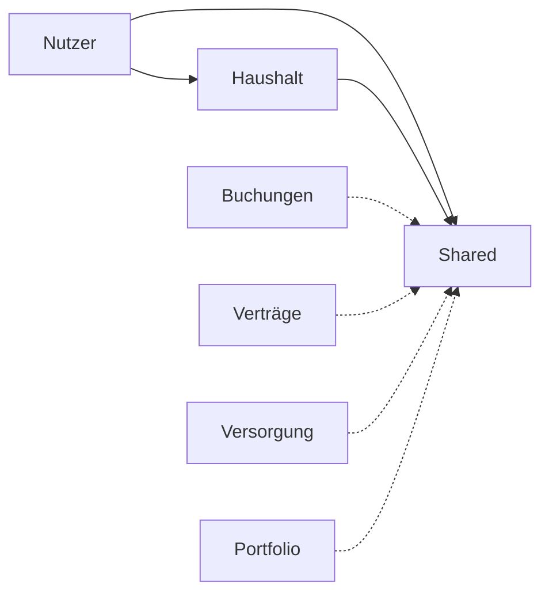

# Haushaltsbuch-Backend

Backend der Haushaltsbuch-Anwendung: ein modularer Monolith auf Basis von Spring Boot,
mit PostgreSQL als Datenbank und Keycloak als Identity Provider.

## Voraussetzungen

- JDK 25
- Docker oder Podman inkl. Docker Compose (`docker compose` oder `docker-compose`)
- Maven muss nicht installiert sein, der Maven Wrapper (`./mvnw`) ist enthalten.

### Hinweis für Podman

Testcontainers und der Docker Compose Support erwarten eine Docker-kompatible API.
Bei Podman den Socket aktivieren und `DOCKER_HOST` setzen:

```bash
systemctl --user enable --now podman.socket
export DOCKER_HOST=unix://$XDG_RUNTIME_DIR/podman/podman.sock
```

Falls der Ryuk-Container von Testcontainers unter rootless Podman nicht startet,
zusätzlich `TESTCONTAINERS_RYUK_DISABLED=true` setzen.

## Starten

```bash
./mvnw spring-boot:run
```

Ohne gesetztes Profil läuft die Anwendung im Profil `dev` gegen eine lokal laufende
PostgreSQL-Instanz auf `localhost:5432` und Keycloak auf `localhost:8180` (Zugangsdaten und
Defaults siehe [Konfiguration](#konfiguration)). Backend: http://localhost:8080, Swagger UI unter
`/swagger-ui.html`.

Keycloak ist immer angebunden, auch lokal; eine offene Konfiguration ohne Anmeldung gibt es
nicht. Das Backend startet auch ohne laufenden Keycloak, Anmeldung und Registrierung schlagen
dann aber fehl, und der [Systemstatus](#systemstatus) meldet `keycloak` als `DOWN`.

### Lokal mit Keycloak

1. Keycloak starten, z.&nbsp;B. per `docker compose up -d keycloak` (siehe
   [Docker Compose](#docker-compose)). Der Realm wird beim ersten Start automatisch eingerichtet,
   siehe [Keycloak einrichten](#keycloak-einrichten).
2. Backend starten: `./mvnw spring-boot:run`. Das Client-Secret ist in dev mit dem Realm-Import
   abgestimmt (`dev-secret`) und muss nicht gesetzt werden.
3. Konto über `POST /api/registrierung` anlegen (siehe [Registrierung](#registrierung)), danach
   Anmeldung testen, z.&nbsp;B. mit curl (CSRF-Token aus dem Cookie holen, dann anmelden):

   ```bash
   curl -s -c /tmp/kc.txt http://localhost:8080/actuator/health >/dev/null
   XSRF=$(awk '/XSRF-TOKEN/{print $7}' /tmp/kc.txt)
   curl -i -b /tmp/kc.txt -c /tmp/kc.txt -H "X-XSRF-TOKEN: $XSRF" -H 'Content-Type: application/json' \
     -d '{"email":"max@example.org","passwort":"Geheim123!"}' http://localhost:8080/api/anmeldung
   curl -b /tmp/kc.txt http://localhost:8080/api/nutzer/ich/komponenten
   ```

### Docker Compose

`compose.yaml` enthält PostgreSQL (App-Datenbank plus separate `keycloak`-Datenbank) und
Keycloak mit Realm-Import. Der automatische Start durch Spring Boot ist vorerst aus, weil eine
eigene PostgreSQL-Instanz genutzt wird; einschalten mit `DOCKER_COMPOSE_ENABLED=true`
(dann darf auf Port 5432 nichts anderes laufen).

Manuell starten:

```bash
docker compose up -d            # PostgreSQL und Keycloak
docker compose up -d keycloak   # nur Keycloak (startet den PostgreSQL-Container mit)
```

Der Keycloak-Container hängt vom PostgreSQL-Container aus `compose.yaml` ab. Läuft auf Port 5432
bereits eine andere PostgreSQL-Instanz, `POSTGRES_PORT` auf einen freien Port setzen
(z.&nbsp;B. `POSTGRES_PORT=5433`). Das Init-Skript unter `docker/postgres/init/` legt die
Keycloak-Datenbank nur beim allerersten Start des Volumes an; bei einem bestehenden Volume
muss sie bereits existieren.

Variablen für `compose.yaml` (per Umgebung oder `.env`-Datei):

| Variable                  | Default         |
|---------------------------|-----------------|
| `POSTGRES_PORT`           | `5432`          |
| `POSTGRES_DB`             | `haushaltsbuch` |
| `POSTGRES_USER`           | `haushaltsbuch` |
| `POSTGRES_PASSWORD`       | `haushaltsbuch` |
| `KEYCLOAK_DB`             | `keycloak`      |
| `KEYCLOAK_DB_USER`        | `keycloak`      |
| `KEYCLOAK_DB_PASSWORD`    | `keycloak`      |
| `KEYCLOAK_PORT`           | `8180`          |
| `KEYCLOAK_ADMIN`          | `admin`         |
| `KEYCLOAK_ADMIN_PASSWORD` | `admin`         |
| `KEYCLOAK_CLIENT_SECRET`  | `dev-secret`    |

## Keycloak einrichten

Der Realm `haushaltsbuch` liegt versioniert unter `docker/keycloak/import/haushaltsbuch-realm.json`
und wird beim Start mit `--import-realm` eingespielt (in `compose.yaml` bereits gesetzt). Der Import
greift nur, wenn es den Realm noch nicht gibt; ein bestehender Realm wird nicht verändert.
Änderungen an der Datei wirken daher nur auf neue Keycloak-Instanzen, in bestehenden muss man sie
von Hand nachziehen.

- **Client-Secret:** steht nicht in der Datei, sondern wird beim Import aus der Umgebungsvariablen
  `KEYCLOAK_CLIENT_SECRET` des Keycloak-Containers gelesen (Default `dev-secret`, passend zum
  Default des Backends in dev).
- **Nutzer:** enthält der Import keine, nur den Service Account des Clients.
- **Einzeln gestarteter Container** (ohne `compose.yaml`): Verzeichnis einbinden und Import
  aktivieren, z.&nbsp;B.

  ```bash
  podman run -d --name keycloak -p 8180:8080 \
    -v ./docker/keycloak/import:/opt/keycloak/data/import:ro,Z \
    -e KEYCLOAK_CLIENT_SECRET=dev-secret \
    -e KC_BOOTSTRAP_ADMIN_USERNAME=admin -e KC_BOOTSTRAP_ADMIN_PASSWORD=admin \
    quay.io/keycloak/keycloak:26.8.1 start-dev --import-realm
  ```

  (`:Z` setzt das SELinux-Label, z.&nbsp;B. unter Fedora; ohne Angabe von `KC_DB*` speichert
  Keycloak in einer internen Datenbank im Container.)

Die folgenden Schritte beschreiben, was der Import einrichtet. Sie dienen als Referenz, z.&nbsp;B.
um eine bestehende Instanz von Hand anzupassen (Admin-Konsole lokal http://localhost:8180,
Dev-Zugang `admin` / `admin`, alle Schritte außer dem ersten im Realm `haushaltsbuch`):

1. **Realm anlegen:** Realm-Auswahl oben links → *Create realm* → Name `haushaltsbuch`.
2. **Login-Einstellungen:** *Realm settings* → Reiter *Login*:
   - *User registration* **aus**: Konten entstehen nur über `POST /api/registrierung`, damit
     zu jedem Konto auch ein Nutzer mit Komponenten in unserer Datenbank existiert.
   - *Login with email* **an**
   - *Duplicate emails* **aus**: Die Registrierung erkennt vergebene E-Mail-Adressen an der
     Antwort 409 von Keycloak.
3. **Passwort-Richtlinie:** *Authentication* → Reiter *Policies* → *Password policy*.
   Mindestlänge nicht unter 8, das Backend prüft selbst nur diese Länge. Strengere Regeln
   (Ziffern, Sonderzeichen usw.) prüft Keycloak; Verstöße gibt die Registrierung als 400 mit
   der Meldung von Keycloak zurück.
4. **Client anlegen:** *Clients* → *Create client*:
   - *Client type* `OpenID Connect`, *Client ID* `haushaltsbuch-backend`
   - *Client authentication* **an** (Confidential Client)
   - *Authentication flow*: *Direct access grants* **an** (Anmeldung mit E-Mail und Passwort
     über das Backend), *Service accounts roles* **an** (Registrierung), *Standard flow* **aus**
     (es gibt keine Weiterleitung zu Keycloak, Redirect-URIs werden daher nicht gebraucht)
5. **Rolle für den Service Account:** *Clients* → `haushaltsbuch-backend` → Reiter
   *Service account roles* → *Assign role* → Filter *Filter by clients* → `manage-users` von
   `realm-management` zuweisen. Ohne diese Rolle schlägt die Registrierung mit einem Fehler der
   Admin API fehl. Die Rolle deckt auch das Löschen ab (siehe [Registrierung](#registrierung)).
6. **Client-Secret:** Reiter *Credentials* → *Client Secret* kopieren und als
   `KEYCLOAK_CLIENT_SECRET` setzen (der Import setzt es aus derselben Variablen).
7. **Sperre nach Fehlversuchen:** *Realm settings* → Reiter *Security defenses* →
   *Brute force detection* einschalten. Das Login-Formular der SPA prüft Passwörter über das
   Backend; ohne Sperre ließen sie sich dort beliebig durchprobieren. Der Keycloak-Standard
   (30 Fehlversuche) ist großzügig, vor prod niedriger ansetzen (z.&nbsp;B. 5–10).
8. **Keine Pflichtschritte:** Unter *Authentication* → *Required actions* keine Aktion als
   *Default action* aktivieren und Konten nicht mit temporärem Passwort anlegen. Die Seiten, auf
   denen Keycloak solche Schritte abfragt, werden nie angezeigt; ein Konto mit offenem
   Pflichtschritt kann sich nicht anmelden (Antwort 403, `code` `ANMELDUNG_NICHT_EINGERICHTET`).

Benutzer werden mit der E-Mail-Adresse als Benutzername angelegt.

Außerdem setzt der Import *Require SSL* auf `none` (*Realm settings* → *General*): Hinter dem
Port-Forwarding von Podman gelten Anfragen nicht als lokal, mit dem Keycloak-Standard `external`
lehnt Keycloak sie daher ohne HTTPS ab.

### Für prod zusätzlich

- Keycloak mit `start` statt `start-dev`, mit HTTPS und eigenem Hostnamen betreiben.
- *Require SSL* im Realm wieder auf `external` oder `all` setzen (der Import setzt `none`).
- `KEYCLOAK_CLIENT_SECRET` beim Import auf ein eigenes, zufälliges Secret setzen.
- Den Bootstrap-Admin durch ein echtes Admin-Konto ersetzen.
- Backend und Keycloak nur über HTTPS verbinden: Das Backend schickt Passwörter an Keycloak.
- `KEYCLOAK_ISSUER_URI`, `KEYCLOAK_CLIENT_ID`, `KEYCLOAK_CLIENT_SECRET` und `KEYCLOAK_ADMIN_URI`
  setzen; im Profil `prod` gibt es keine Defaults.

## Anmeldung und Zugriffsschutz

Es gibt zwei Wege der Anmeldung über dieselbe Filterkette:

- **Session:** Die SPA hat ein eigenes Login-Formular und schickt E-Mail und Passwort an
  `POST /api/anmeldung`. Das Backend holt damit die Tokens direkt bei Keycloak (Password Grant,
  in Keycloak *Direct access grants*) und legt die Session an; die SPA erhält nur das
  Session-Cookie. Es gibt keine Weiterleitung zu Keycloak.
- **Bearer-Token:** Anfragen mit einem Access Token von Keycloak (z.&nbsp;B. andere Clients, Tests)
  werden gegen den Realm geprüft.

### Ablauf für die SPA

- **CSRF:** Das Backend setzt das Cookie `XSRF-TOKEN` (bei jeder Antwort, auch bei 401). Jede
  schreibende Anfrage, auch Anmeldung und Registrierung, schickt den Wert im Header
  `X-XSRF-TOKEN` zurück. Nach der Anmeldung wird das Token erneuert; Angular liest es dafür
  ohnehin vor jeder Anfrage neu aus dem Cookie.
- **Beim Start:** `GET /api/nutzer/ich/komponenten`. **401** → Login-Seite zeigen, **200** →
  angemeldet, Bereiche nach der Liste einblenden.
- **Anmeldung:** `POST /api/anmeldung` mit `{"email": "...", "passwort": "..."}`.
  - **204**: angemeldet, Session-Cookie gesetzt
  - **401**, `code` `ANMELDUNG_UNGUELTIG`: E-Mail-Adresse oder Passwort falsch
  - **403**, `code` `ANMELDUNG_GESPERRT`: Konto deaktiviert oder nach Fehlversuchen vorübergehend gesperrt
  - **403**, `code` `ANMELDUNG_NICHT_EINGERICHTET`: in Keycloak stehen Pflichtschritte aus
  - **400**, `code` `VALIDIERUNG`: Felder fehlen
- **Registrierung:** Nach **201** ist der Nutzer direkt angemeldet. Scheitert nur die automatische
  Anmeldung, bleibt es bei 201 und die SPA zeigt die Login-Seite (erkennbar an der 401 beim
  nächsten Aufruf).
- **Abmeldung:** `POST /api/abmeldung` → **204**. Beendet die Session im Backend und die Sitzung
  bei Keycloak.

Die SPA muss das Backend über denselben Origin erreichen, lokal über den Angular-Dev-Proxy
(`/api` auf `http://localhost:8080`). Nur dann schickt der Browser Session- und XSRF-Cookie mit;
CORS ist im Backend nicht konfiguriert.

### Sitzung

Die Session im Backend speichert das Refresh Token von Keycloak. Läuft das Access Token ab
(Standard 5 Minuten), erneuert das Backend die Sitzung beim nächsten Request bei Keycloak.
Lehnt Keycloak das ab (Sitzung abgelaufen oder in Keycloak beendet, Konto deaktiviert), wird
die Session beendet und der Request erhält 401. Ein in Keycloak gesperrter Nutzer ist also
spätestens nach Ablauf des Access Tokens abgemeldet. Ist Keycloak nicht erreichbar, bleibt die
Session bestehen und die Erneuerung wird beim nächsten Request wiederholt.

Wie lange eine Anmeldung ohne Aktivität hält, bestimmt das Kürzere aus Session-Timeout des
Backends (Standard 30 Minuten) und *SSO Session Idle* im Realm (Standard 30 Minuten).

### Antworten und öffentliche Endpunkte

Antworten unter `/api/**`: **401** ohne Anmeldung (`NICHT_ANGEMELDET`), **403** bei fehlender
Berechtigung (`KEIN_ZUGRIFF`) oder fehlendem CSRF-Token (`CSRF_TOKEN_UNGUELTIG`); zum Format siehe
[Fehlerantworten](#fehlerantworten).

Öffentlich ohne Anmeldung sind nur `/actuator/health/**`, `/actuator/info`,
`POST /api/registrierung`, `POST /api/anmeldung` und im dev-Profil die OpenAPI-Dokumentation.

### Komponenten

Bei der Registrierung wählt der Nutzer Komponenten; sie entscheiden, welche Fachbereiche er
nutzen darf. Die Komponenten gehören seinem Haushalt und liegen in unserer Datenbank
(`haushalt_komponente`), nicht als Rollen in Keycloak. Änderungen greifen so sofort und nicht erst nach einem neuen Login.

| Komponente             | Modul        | API-Pfad              |
|------------------------|--------------|-----------------------|
| `FINANZUEBERSICHT`     | `buchungen`  | `/api/buchungen/**`   |
| `VERTRAGSUEBERSICHT`   | `vertraege`  | `/api/vertraege/**`   |
| `VERSORGUNGSVERTRAEGE` | `versorgung` | `/api/versorgung/**`  |
| `PORTFOLIO`            | `portfolio`  | `/api/portfolio/**`   |

`SecurityConfig` prüft bei jeder Anfrage auf einen dieser Pfade, ob der Nutzer die Komponente
bzw. sein Haushalt die Komponente gebucht hat, sonst **403**. **Neue Endpunkte eines Fachmoduls müssen unter dessen API-Pfad
liegen**; ein Endpunkt außerhalb ist für jeden angemeldeten Nutzer erreichbar.

Die SPA fragt die gebuchten Komponenten über `GET /api/nutzer/ich/komponenten` ab und blendet
danach Bereiche ein oder aus. Das ist reine Anzeige, der Schutz liegt im Backend.

Die Nutzer-ID im Code ist immer die Keycloak-ID (Claim `sub`), als `UUID` ermittelt über
`AngemeldeterNutzer.id(...)`.

Keycloak-Rollen werden derzeit nicht ausgewertet. Werden sie später gebraucht (z.&nbsp;B. für einen
Admin-Bereich), steht in `SecurityConfig`, wie sie übernommen werden.

### Haushalte

Fachdaten gehören einem **Haushalt** (Modul `haushalt`), nicht einem einzelnen Nutzer. Ein
Haushaltsbuch kann so von mehreren Nutzern gemeinsam geführt werden.

- Tabellen: `haushalt` (`id`, optionaler `name`, `angelegt_am`), `haushalt_mitglied`
  (`haushalt_id`, `nutzer_id`) und `haushalt_komponente`. Vorerst gehört ein Nutzer zu genau
  einem Haushalt (Unique auf `nutzer_id`); das Schema erlaubt mehrere Mitglieder je Haushalt.
- Die Registrierung legt einen Haushalt mit dem Nutzer als einzigem Mitglied und den gewählten
  Komponenten an. Gebuchte Komponenten gelten für den ganzen Haushalt.
- **Fachtabellen speichern `haushalt_id` (UUID), nicht `nutzer_id`**, ohne Fremdschlüssel über
  Modulgrenzen. Den Haushalt des angemeldeten Nutzers liefert `AktuellerHaushalt` (öffentliche
  API des Moduls `haushalt`):

  ```java
  @GetMapping
  List<Buchung> buchungen(Authentication authentication) {
      UUID haushaltId = aktuellerHaushalt.id(authentication);
      return buchungRepository.findByHaushaltId(haushaltId);
  }
  ```

  Jeder Zugriff filtert auf diese ID. Daten eines fremden Haushalts liefern **404**, nicht 403,
  damit keine Rückschlüsse auf fremde Daten möglich sind. Gehört der Nutzer keinem Haushalt an,
  wirft `id(...)` 403 (Fachbereiche erreicht er dann ohnehin nicht, da ohne Haushalt keine
  Komponenten gebucht sind).

Weitere Mitglieder einladen:
[#15](https://github.com/bjoernb94/Haushaltsbuch-Backend/issues/15).

## API

| Endpunkt                          | Zugriff         | Beschreibung                                    |
|-----------------------------------|-----------------|-------------------------------------------------|
| `POST /api/registrierung`         | öffentlich      | Konto in Keycloak und Nutzer anlegen            |
| `GET /api/nutzer/ich`             | angemeldet      | Profil: `vorname`, `name`, `email`              |
| `GET /api/nutzer/ich/komponenten` | angemeldet      | Gebuchte Komponenten, z.&nbsp;B. `["PORTFOLIO"]`|
| `POST /api/anmeldung`             | öffentlich      | Anmeldung mit E-Mail und Passwort (Session)     |
| `POST /api/abmeldung`             | angemeldet      | Abmeldung, auch bei Keycloak                    |
| `/actuator/health`                | öffentlich      | Health Check, inkl. Probes `liveness`/`readiness`|
| `/actuator/health/systemstatus`   | öffentlich      | Status für die Login-Seite: `db`, `keycloak`     |

Die vollständige API-Beschreibung liefert die Swagger UI (`/swagger-ui.html`, nur dev).

### Systemstatus

`GET /actuator/health/systemstatus` liefert nur `UP`/`DOWN` je Komponente, ohne Details;
ist eine Komponente `DOWN`, antwortet der Endpunkt mit 503:

```json
{ "status": "UP", "components": { "db": { "status": "UP" }, "keycloak": { "status": "UP" } } }
```

`keycloak` prüft das OIDC-Discovery-Dokument des Realms (Timeout 2&nbsp;s) und merkt sich das
Ergebnis 10&nbsp;s, damit der öffentliche Endpunkt Keycloak nicht mit Anfragen belastet. Da `keycloak` auch in
`/actuator/health` eingeht, sollten Container-Healthchecks die Probes `liveness`/`readiness`
verwenden, sonst wird das Backend bei einem Keycloak-Ausfall neu gestartet.

### Fehlerantworten

Alle Fehler kommen als `ProblemDetail` (RFC 9457, `Content-Type: application/problem+json`). Die
SPA erkennt den Fehler an `code` und zeigt den Text selbst in der Sprache des Nutzers an; `detail`
ist englisch und nur für Entwickler und Logs gedacht.

```json
{
  "type": "about:blank",
  "title": "Bad Request",
  "status": 400,
  "detail": "Request contains invalid fields.",
  "instance": "/api/registrierung",
  "code": "VALIDIERUNG",
  "felder": [
    { "feld": "passwort", "code": "Size", "parameter": { "min": 8 } },
    { "feld": "email", "code": "Email", "parameter": {} }
  ]
}
```

Bei `VALIDIERUNG` listet `felder` jeden Verstoß einzeln (ein Feld kann mehrere haben): `code` ist
der Name der Bean-Validation-Annotation (`NotBlank`, `NotEmpty`, `Size`, `Email` …), `parameter`
enthält deren gesetzte Attribute (z.&nbsp;B. `min`, `max`).

| `code`                 | Status | Bedeutung                                                     |
|------------------------|--------|---------------------------------------------------------------|
| `VALIDIERUNG`          | 400    | Ungültige Felder im Request-Body, siehe `felder`              |
| `ANFRAGE_UNGUELTIG`    | 400    | Request nicht lesbar (kaputtes JSON, unbekannter Enum-Wert …) |
| `NICHT_ANGEMELDET`     | 401    | Keine oder abgelaufene Anmeldung                              |
| `KEIN_ZUGRIFF`         | 403    | Keine Berechtigung, z.&nbsp;B. Komponente nicht gebucht       |
| `CSRF_TOKEN_UNGUELTIG` | 403    | CSRF-Token fehlt oder ist ungültig                            |
| `NICHT_GEFUNDEN`       | 404    | Unbekannter Pfad oder Datensatz, auch eines fremden Haushalts |
| `METHODE_NICHT_ERLAUBT`| 405    | HTTP-Methode nicht unterstützt                                |
| `INTERNER_FEHLER`      | 500    | Unerwarteter Fehler; Details nur im Log                       |

Dazu kommen die Codes der einzelnen Endpunkte (siehe [Anmeldung](#ablauf-für-die-spa) und
[Registrierung](#registrierung)). Allgemeine Fehler beantwortet `shared.fehler.FehlerBehandlung`
zentral; Module werfen dafür z.&nbsp;B. `NichtGefundenException`. Modulspezifische Fehler beantworten
die Controller des Moduls mit `Probleme.problem(status, code, detail)` und einem eigenen Code
(`GROSSBUCHSTABEN_MIT_UNTERSTRICH`, deutsch).

Ausnahme: Anfragen mit ungültigem Bearer-Token beantwortet der Resource Server weiterhin mit
leerem 401 und `WWW-Authenticate`-Header; die SPA nutzt die Session und ist davon nicht betroffen.

### Geldbeträge und Datum

Geldbeträge sind überall der Typ `shared.geld.Betrag` mit Wert und Währung:

```json
{ "wert": 12.34, "waehrung": "EUR" }
```

- Der Wert ist eine JSON-Zahl mit höchstens 2 Nachkommastellen und darf negativ sein. Summen und
  andere Berechnungen macht das Backend, die SPA formatiert nur.
- Vorerst ist nur `EUR` erlaubt; der Typ ist für weitere Währungen ausgelegt (Fremdwährungen:
  [#30](https://github.com/bjoernb94/Haushaltsbuch-Backend/issues/30)). Rechnen geht nur mit
  Beträgen derselben Währung, Summen gruppieren nach Währung.
- Rundung kaufmännisch (`HALF_UP`, 2,345 → 2,35), nur bei Berechnungen; Eingaben mit mehr als 2
  Nachkommastellen werden abgelehnt.
- Validierung: Request-DTOs markieren Beträge mit `@NotNull @Valid`. Fehler erscheinen in `felder`,
  z.&nbsp;B. `{ "feld": "preis.wert", "code": "Digits", "parameter": { "integer": 17, "fraction": 2 } }`
  oder `{ "feld": "preis.waehrung", "code": "ErlaubteWaehrung" }`.

Fachliche Daten (Buchungsdatum, Vertragsbeginn) sind `LocalDate`, im JSON ISO-8601 (`2026-10-31`).
„Heute“ bestimmen Module mit `LocalDate.now(clock)` über das `Clock`-Bean (Zeitzone
Europe/Berlin). Zeitstempel sind `Instant` und werden in UTC gespeichert.

### Registrierung

`POST /api/registrierung` (CSRF-Token nötig):

```json
{
  "email": "max@example.org",
  "passwort": "Geheim123!",
  "vorname": "Max",
  "name": "Muster",
  "komponenten": ["FINANZUEBERSICHT", "PORTFOLIO"]
}
```

Antworten: **201** angelegt, **400** ungültige Daten (`VALIDIERUNG`) oder von Keycloak abgelehnt,
z.&nbsp;B. wegen der Passwort-Richtlinie (`REGISTRIERUNG_ABGELEHNT`), **409** E-Mail bereits vergeben
(`EMAIL_BEREITS_VERGEBEN`). Nach 201 ist der Nutzer direkt angemeldet.

Ablauf: Erst wird das Konto über die Keycloak Admin API angelegt, dann werden in einer
Transaktion der Nutzer und sein Haushalt mit den Komponenten gespeichert. Schlägt das Speichern fehl, wird das Konto wieder gelöscht. Schlägt
auch das Löschen fehl, steht im Log *„Konto … konnte nicht gelöscht werden und muss manuell
entfernt werden“*; das Konto dann in Keycloak unter *Users* löschen.

Ein Konto, das direkt in Keycloak angelegt wird, hat keinen Nutzer in unserer Datenbank und
damit keinen Haushalt und keine Komponenten: Login klappt, alle Fachbereiche antworten mit 403.

### Offene Aufgaben

Geplante Erweiterungen und bekannte Lücken (z.&nbsp;B. „Passwort vergessen“, Profilbereich,
Keycloak für prod) werden als [GitHub Issues](https://github.com/bjoernb94/Haushaltsbuch-Backend/issues)
gepflegt und sind Meilensteinen zugeordnet.

## Konfiguration

Die Konfiguration liegt ausschließlich in `src/main/resources/application.yml`
(Profile `dev` und `prod`). Werte kommen aus Umgebungsvariablen; im Profil `dev`
gibt es Defaults für die lokale Entwicklung, im Profil `prod` sind alle Variablen Pflicht.

| Variable                 | Dev-Default                                      |
|--------------------------|--------------------------------------------------|
| `DB_URL`                 | `jdbc:postgresql://localhost:5432/haushaltsbuch` |
| `DB_USERNAME`            | `haushaltsbuch`                                  |
| `DB_PASSWORD`            | `haushaltsbuch`                                  |
| `KEYCLOAK_ISSUER_URI`    | `http://localhost:8180/realms/haushaltsbuch`     |
| `KEYCLOAK_CLIENT_ID`     | `haushaltsbuch-backend`                          |
| `KEYCLOAK_CLIENT_SECRET` | `dev-secret` (passend zum Realm-Import)          |
| `KEYCLOAK_ADMIN_URI`     | `http://localhost:8180/admin/realms/haushaltsbuch` |
| `DOCKER_COMPOSE_ENABLED` | `false`                                          |

`KEYCLOAK_ADMIN_URI`
zeigt auf die Admin REST API des Realms, über die die Registrierung Konten anlegt; Anmeldung und
Admin API nutzen denselben Client und dasselbe Secret.

Die Keycloak-Endpunkte sind explizit konfiguriert statt über OIDC-Discovery. Dadurch startet
das Backend auch, wenn Keycloak (noch) nicht erreichbar ist.

Produktiv starten mit `SPRING_PROFILES_ACTIVE=prod`. Dort sind der Docker Compose Support
sowie Swagger UI und die OpenAPI-Dokumentation deaktiviert.

### Datenbank

Das Datenbankschema wird ausschließlich über Flyway (`src/main/resources/db/migration`)
gepflegt; Hibernate prüft es nur (`ddl-auto: validate`). Jede neue Entity braucht daher eine
Migration, sonst startet die Anwendung nicht.

Namenskonvention: `V<n>__<modul>_<beschreibung>.sql`, z.&nbsp;B. `V3__buchungen_kategorien.sql`.
Bereits ausgelieferte Migrationen nicht mehr ändern, sondern eine neue anlegen.

Spalten für Geldbeträge und Datum:

| Java                    | Spalte(n)                                                    |
|-------------------------|--------------------------------------------------------------|
| `Betrag preis`          | `preis_wert NUMERIC(19, 2)`, `preis_waehrung VARCHAR(3)`     |
| `LocalDate buchungstag` | `DATE`                                                       |
| `Instant angelegtAm`    | `TIMESTAMPTZ`                                                |

Die Namen eingebetteter Werte bildet Hibernate aus Feldname und Komponente
(`ImplicitNamingStrategyComponentPathImpl`), daher passen mehrere Beträge in eine Tabelle.

Migrationen nur für Tests liegen in `src/test/resources/db/migration` mit Versionen ab 1000.

Die Tabelle `nutzer` speichert nur die Keycloak-ID; E-Mail, Name und Passwort liegen
ausschließlich in Keycloak, die gebuchten Komponenten beim [Haushalt](#haushalte).

## Build und Tests

```bash
./mvnw verify                                     # Build inkl. aller Tests
./mvnw test -Dtest=ModularityTests                # einzelne Testklasse
./mvnw test -Dtest=SecurityConfigTests#healthIsPublic   # einzelne Testmethode
./mvnw spring-boot:build-image -DskipTests        # Container-Image bauen
```

Integrationstests starten PostgreSQL per Testcontainers und benötigen daher eine laufende
Container-Umgebung. Ein Container wird für den ganzen Testlauf geteilt. Keycloak wird in den
Tests nicht gebraucht: Die Tests simulieren die Anmeldung (`jwt()`, `oidcLogin()`), alle Zugriffe
auf Keycloak sind Mocks. `ModularityTests` prüft die Modulstruktur mit Spring Modulith und
schreibt die [Modul-Dokumentation](#module-und-abhängigkeiten).

### Aufbau der Tests

Jede abweichende Konfiguration (eigene `@MockitoBean`s, Properties, Profile) erzeugt einen
eigenen Spring-Kontext und verlangsamt den Build. Daher gibt es zwei Annotationen
(unter `src/test`, Paket `de.bochmann.haushaltsbuch`):

| Annotation         | Wofür                                              | Kontext                         |
|--------------------|----------------------------------------------------|---------------------------------|
| `@IntegrationTest` | Web- und Security-Tests (MockMvc, Filterkette), modulübergreifende Abläufe | ganze Anwendung, ein gemeinsamer Kontext |
| `@ModuleTest`      | Fachlogik eines Moduls (Services, Repositories)    | nur das Modul der Testklasse (`@ApplicationModuleTest`), einer je Modul |

`@IntegrationTest` setzt Profil `dev`, Testcontainers und MockMvc und ersetzt alle
Keycloak-Zugriffe:

- `Identitaetsanbieter` (Admin API) und `KeycloakTokenClient` (Token-Endpunkt) sind Mocks,
  `Anmeldung` ist ein Spy (arbeitet echt gegen den gemockten Token-Endpunkt, lässt sich aber
  mit `verify`/`doThrow` steuern).
- Der Health-Indikator `keycloakHealthIndicator` ist ein Mock und meldet vor jedem Test `UP`.

Tests holen sich die Mocks per `@Autowired` und legen ihr Verhalten mit `when(...)` fest; Spring
setzt sie nach jedem Test zurück. Eigene `@MockitoBean`s nur in begründeten Ausnahmen, ebenso
`@DirtiesContext` (Beispiel: `CsrfCookieTests`, das einen frischen Kontext braucht).

`@ModuleTest` startet nur die Beans des eigenen Moduls. Greift das Modul auf Beans anderer Module
zu, schlägt der Start fehl; diese dann in der Testklasse mit `@MockitoBean` ersetzen.
Testdaten anderer Module in einem `@IntegrationTest` über deren öffentliche API anlegen
(z.&nbsp;B. `HaushaltService.anlegen(...)`), nicht über Mocks.

Unit-Tests ohne Spring (z.&nbsp;B. `KeycloakTokenClientTests`) brauchen keine der Annotationen.

Zum lokalen Start mit Testcontainers statt Docker Compose:
`TestHaushaltsbuchBackendApplication` (unter `src/test`) ausführen.

Die GitHub Action `.github/workflows/build.yml` führt bei jedem Push auf `main` und bei jedem
Pull Request `./mvnw verify` aus und lädt bei Fehlern die Testberichte hoch.

Dependabot (`.github/dependabot.yml`) öffnet Pull Requests für neue Versionen: Maven wöchentlich,
GitHub Actions und die Images aus `compose.yaml` monatlich. Major-Updates von PostgreSQL sind
ausgenommen, weil sie eine Datenmigration brauchen. Keycloak-Updates vor dem Merge lokal mit
Registrierung und Anmeldung testen; die Tests im Build laufen ohne Keycloak.

### Arbeitsweise mit Git

Auf `main` wird nicht direkt committet. Jede Änderung entsteht auf einem eigenen Branch und
kommt per Pull Request nach `main`, sobald der Build grün ist.

- Branch-Namen: `feature/<kurzname>` für neue Funktionen, `fix/<kurzname>` für Fehlerbehebungen,
  `docs/<kurzname>` für reine Doku-Änderungen, `chore/<kurzname>` für Wartung (Abhängigkeiten,
  Konfiguration, Umbauten ohne neue Funktion). Gehört der Branch zu einem Issue, die Nummer
  voranstellen, z.&nbsp;B. `feature/14-haushalt`.
- Im Pull Request das Issue mit `Closes #<nummer>` verknüpfen, damit es beim Merge geschlossen wird.
- Branches nach dem Merge löschen.

### IntelliJ Run Configurations

Unter `.run/` liegen gemeinsame Run Configurations (Spring-Boot-Start sowie Maven-Aufrufe für
Build, Tests, Dependency-Checks, Image-Build und Flyway). Sie enthalten die lokalen Dev-Werte
(DB `postgres` auf `localhost:5432`, Podman-Socket unter `/run/user/1000`) und müssen auf anderen
Rechnern ggf. angepasst werden. `flyway:info` / `flyway:validate` arbeiten direkt gegen die
lokale Datenbank; die Migration selbst führt Spring Boot beim Start aus.

## Projektstruktur

Paketiert nach Fachbereichen, nicht nach technischen Schichten. Jedes direkte Unterpaket
von `de.bochmann.haushaltsbuch` ist ein Spring-Modulith-Modul:

```
de.bochmann.haushaltsbuch
├── buchungen    Ein-/Ausgaben, Kategorien
├── vertraege    Verträge, Laufzeiten, Kündigungsfristen
├── versorgung   Strom, Gas, Wasser, Abschläge, Zählerstände
├── portfolio    Depots, Positionen, Kurse
├── haushalt     Haushalt, Mitglieder, gebuchte Komponenten
├── nutzer       Registrierung, Profil, Konto in Keycloak
└── shared       Security-Konfiguration, Fehlerbehandlung, gemeinsame Typen (z. B. Komponente, Betrag)
```

### Module und Abhängigkeiten



Gestrichelt: Module ohne Code bisher, die `shared` nutzen dürfen. Das Diagramm ist von Hand
gepflegt; maßgeblich sind die Diagramme, die `ModularityTests` bei jedem Testlauf mit dem
Documenter von Spring Modulith nach [`docs/module`](docs/module) schreibt (PlantUML, z.&nbsp;B.
`components.puml` für den Überblick und `module-<name>.puml` je Modul, dazu AsciiDoc mit den
Komponenten je Modul). Die Dateien sind eingecheckt: Ändern sich Module oder Abhängigkeiten,
erscheint das im Diff und gehört mit in den Commit; dann auch das Diagramm oben anpassen. Die
GitHub Action prüft nach dem Build, ob `docs/module` dem eingecheckten Stand entspricht, und
schlägt sonst fehl.

Regeln, die `ModularityTests` prüft:

- Nur das Wurzelpaket eines Moduls ist seine öffentliche API; Unterpakete sind intern.
- Keine zyklischen Abhängigkeiten zwischen Modulen.
- `shared` ist offen (`Type.OPEN`) und darf von allen Modulen genutzt werden, selbst aber
  von keinem Fachmodul abhängen. Braucht `shared` Daten aus einem Modul, definiert es eine
  Schnittstelle, die das Modul implementiert (Beispiel: `KomponentenAbfrage`).

Weitere Dateien:

- `compose.yaml`: PostgreSQL und Keycloak für die lokale Entwicklung
- `docker/keycloak/import/`: Realm `haushaltsbuch` für den Import beim Start von Keycloak
- `docker/postgres/init/`: Init-Skript, das die Keycloak-Datenbank anlegt
- `docs/module/`: von `ModularityTests` erzeugte Modul-Dokumentation
- `.github/workflows/build.yml`: Build und Tests in GitHub Actions
