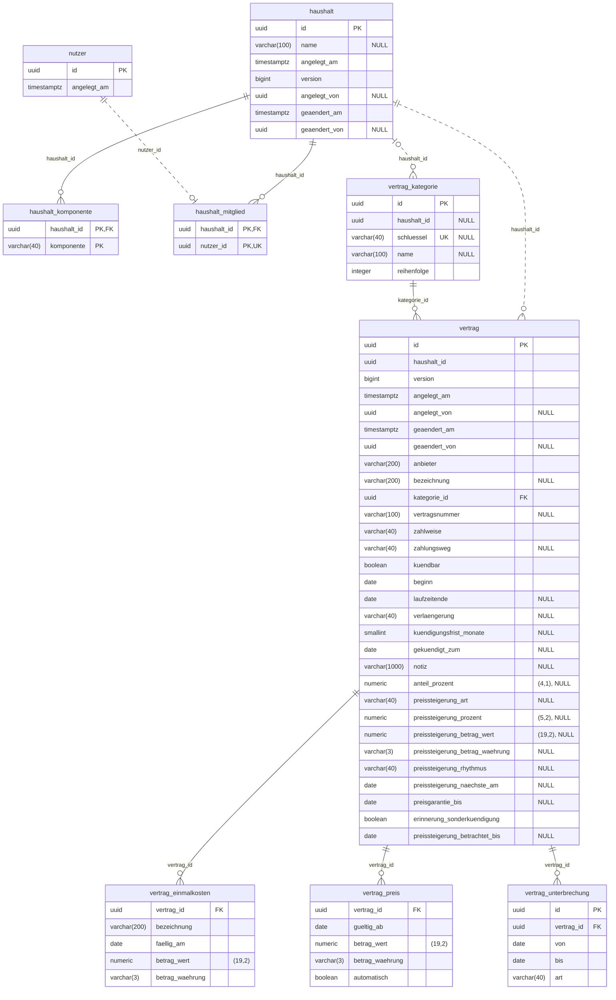

# Datenmodell

Erzeugt von `DatenmodellExportTests` aus dem Schema der Flyway-Migrationen
(`src/main/resources/db/migration`), nicht von Hand ändern. Ändert sich das Schema, die Datei mit
`./mvnw test -Dtest=DatenmodellExportTests` neu erzeugen und mit committen; die CI prüft, ob sie
aktuell ist. Konventionen für das Schema stehen unter [Entwicklung](entwicklung.md#datenbank).

- **Durchgezogene Linie:** Fremdschlüssel, nur innerhalb eines Moduls.
- **Gestrichelte Linie:** Verweis über eine Modulgrenze ohne Fremdschlüssel
  ([ADR 0005](entscheidungen/0005-keine-fremdschluessel-ueber-module.md)), erkannt an einer Spalte
  `<tabelle>_id`. Audit-Spalten wie `angelegt_von` verweisen auch auf einen Nutzer, haben aber keine Linie.
- `PK`, `FK`, `UK`: Primärschlüssel, Fremdschlüssel, eindeutig (nur einspaltig). `NULL`: Spalte darf leer sein.

## Tabellen je Modul

| Modul | Tabellen |
|-------|----------|
| `haushalt` | `haushalt`, `haushalt_komponente`, `haushalt_mitglied` |
| `nutzer` | `nutzer` |
| `vertraege` | `vertrag`, `vertrag_einmalkosten`, `vertrag_kategorie`, `vertrag_preis`, `vertrag_unterbrechung` |
